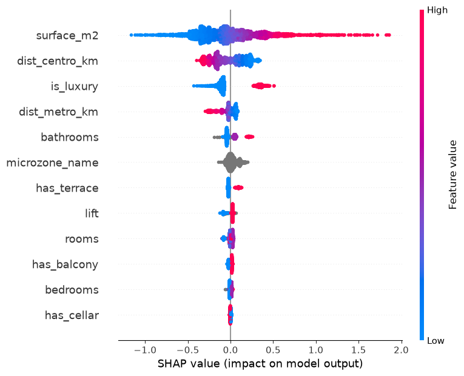
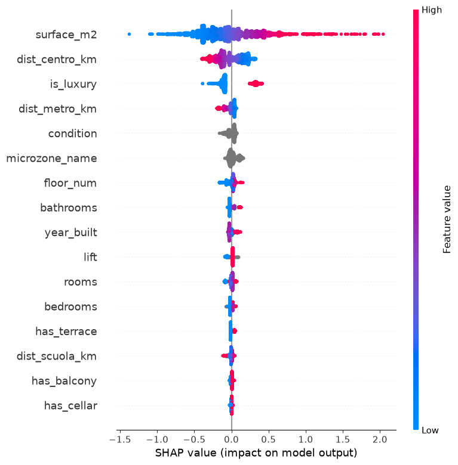
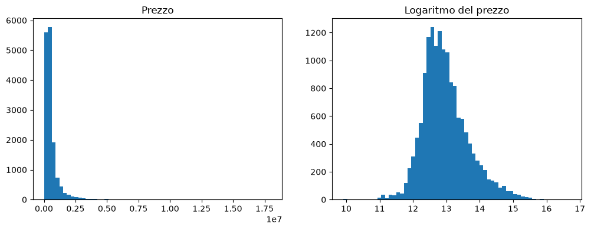

**English** | [Italiano](README.it.md)

# Milano Housing — machine-learning valuation of Milan homes

An **automated valuation model (AVM)** for Milan's residential market. Starting from ~19,000 listings collected from
the Immobiliare.it mobile API, the project builds a model that estimates the asking price of a home from its
features, plus a detector of listings priced unusually low.

The value of the project is not a single accuracy number but the method: every feature was kept only after
measuring its contribution, every dropped row has a documented reason, and validation is designed not to fool
itself.


-0.916-brightgreen)


## Results

- **R² = 0.916** with honest validation (GroupKFold by micro-zone)
- **~13% median error** on homes in neighbourhoods never seen during training
- final model: **CatBoost**, 16 features, trained on **17,086** cleaned listings

Milan prices are explained by a small core of factors: size, centrality, luxury, condition, floor. Most of the
other geographic features tested (parks, schools, stations) turned out to be redundant with the distance from the
city centre.

| Model | R² (GroupKFold) |
| --- | --- |
| Dummy (mean) | 0.00 |
| Linear regression | 0.81 |
| XGBoost | 0.79 |
| **CatBoost** | **0.92** |

<p align="center">
  
  
</p>

## Pipeline

1. **Data collection.** Listings come from the private mobile API of Immobiliare.it, reconstructed by reverse
   engineering the Android app's traffic. Unlike HTML scraping, it returns typed, structured JSON. The crawler
   handles offset pagination, the DataDome anti-bot layer, checkpoints for resuming, and a reconciliation pass for
   the gaps left by an index that moves during collection. *The crawler and the API notes are not published: they
   would only be useful to repeat the collection outside the portal's terms of service.*
2. **Dataset construction** (`src/build_dataset.py`). One JSON detail per line is flattened into ~40 columns,
   **by key, never by position**. Selection decisions (fields with target leakage, amenities reduced to
   present/absent, missing values) live here, downstream of collection, so they can be revised without crawling
   again. An explicit guard keeps price-derived columns (price per m², price band, mortgage data) out of the features.
3. **Cleaning** — from ~19,200 to 17,086 rows, each filter born from inspecting real data: listings without a price,
   auctions and new builds, **bare ownership** (price discounted for someone else's usufruct, found in the description
   text), whole buildings and land, price per m² outside [1,500, 20,000] €, which catches both typos and **listings
   falsely geolocated in Milan**, and floor normalisation.
4. **Geographic enrichment.** Distance from the Duomo, from the nearest metro stop and from the nearest school
   (KDTree on Milan open data). Distances from the centre and the metro are **transferable** to unseen
   neighbourhoods and raised the grouped-validation R² from 0.64 to 0.80.
5. **Modelling.** Models compared on the same grouped validation. CatBoost wins thanks to native handling of the
   high-cardinality micro-zone (145 values) with ordered target encoding. **Validation is by micro-zone, not
   random**, so that twin listings (the same flat re-published, homes in the same building) cannot straddle train
   and test; the gap between random (0.92) and grouped (0.79 without distances) validation measures how much that
   shortcut would inflate the score.
6. **Interpretation (SHAP).** Surface and distance from the centre drive the price, followed by luxury, condition
   and floor.
7. **Application: deal detector.** Turned towards its own residuals, the model flags homes priced below their
   neighbours. Residual analysis showed that the strongest anomalies are rarely real deals: they are defects
   invisible to the model or data errors. Honest conclusion: the market is reasonably efficient and true
   mispricings are rare.

<p align="center"></p>

## Repository

```
milano-housing/
├── src/build_dataset.py          # raw JSONL -> flat table
├── notebooks/analisi_modello.ipynb  # EDA, cleaning, models, SHAP, deal detector
├── src/predict_example.py        # loads the trained model and prices an example home
├── tests/test_build_dataset.py   # unit tests of the dataset builder (no data needed)
├── docs/img/                     # charts used in this README
└── requirements.txt
```

**Not included:** the collected listings, the derived datasets and the trained model. They derive from the
portal's database and cannot be redistributed. The notebook keeps aggregate results and charts; outputs listing
individual ads have been cleared.

## Limits

- **Data source:** collected from a non-public API, outside the portal's terms of service, for personal and study
  use with limited volumes. A commercial use would require a lawful data source.
- **Asking price ≠ sale price:** the model estimates list prices, not deed prices.
- **Static snapshot:** it reflects the market at collection time and needs periodic retraining.
- **Unobserved features:** exposure, view, building quality are not in the data; the model errs systematically
  where they matter (super-luxury, atypical homes).

## Stack

Python · pandas · CatBoost · XGBoost · scikit-learn · SHAP · geopy · SciPy · matplotlib

## License

Source-available under the [PolyForm Strict License 1.0.0](LICENSE): you may read the code and run it for
non-commercial purposes; you may not modify, redistribute or use it commercially without written permission.

---

<sub>© 2026 [Mattia Meligeni](https://mattiameligeni.com). Not affiliated with Immobiliare.it.</sub>
